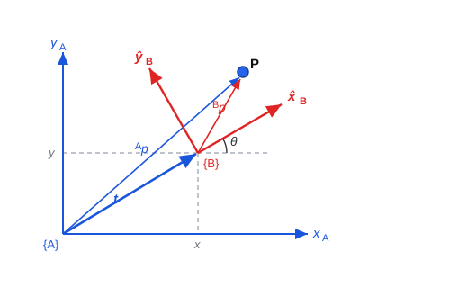
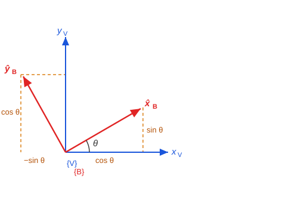

# Marcos de referencia, pose y matriz de rotación 2D

**Fase:** 1 · **Referencia:** Corke cap. 2

## Para qué sirve

Un brazo robótico es una cadena de piezas, cada una girada y trasladada respecto a la anterior. Para saber dónde queda la punta del brazo en el mundo real hace falta una forma de decir "este punto, visto desde esta pieza, ¿dónde está visto desde la base?". Eso es lo que hacen los marcos de referencia y las matrices de rotación. Es la base de todo lo que sigue: cinemática, dinámica y, al final, los torques y la energía.

## Marcos de referencia

Un marco de referencia es un plano cartesiano propio colocado en el espacio. Sobre él se ubican puntos, y cada punto tiene coordenadas **que dependen de qué marco se use para medir**.

Como puede haber varios marcos a la vez, un mismo punto físico se escribe de distintas maneras según desde qué marco se mire. El punto no se mueve; lo que cambia es el "metro" con el que se mide.

**Notación:** el supraíndice de la izquierda indica en qué marco están las coordenadas. Así, ${}^{A}p$ es "el punto $p$ medido desde el marco A", y ${}^{B}p$ es ese mismo punto medido desde B.

## La pose

La **pose** de un marco es *dónde está su origen* y *cómo están orientados sus ejes*, respecto a otro marco. Es decir, la pose **es el marco mismo**.

Conviene no confundir dos cosas:

- Un **punto** solo tiene posición (dos números en 2D).
- Una **pose** tiene posición del origen **y** orientación de los ejes.

## Un punto dentro de un marco

Un punto en el marco A se escribe como una combinación de los ejes de A:

```math
{}^{A}p = p_x\,\hat{x}_A + p_y\,\hat{y}_A
```

Cada coeficiente es una componente **distinta**: $p_x$ es cuánto se avanza en x, $p_y$ cuánto se avanza en y. Un error frecuente es usar el mismo número para los dos; si $p_x = p_y$ siempre, el punto quedaría pegado a la diagonal, y ese no es el caso general.

## ¿Qué pasa si hay dos marcos?

Aquí está el corazón del tema. Para pasar un punto escrito en B hacia A hacen falta dos cosas:

1. **Reinterpretar** el punto usando los ejes de B, pero expresados en coordenadas de A → esto es la **rotación**.
2. **Sumar** dónde está el origen de B visto desde A → esto es la **traslación**.

En una frase: es una *suma vectorial* después de un *cambio de perspectiva*. La fórmula completa es:

```math
\underbrace{{}^{A}p}_{\text{punto en A}} = \underbrace{{}^{A}R_B}_{\text{rota B}\to\text{A}} \cdot \underbrace{{}^{B}p}_{\text{punto en B}} + \underbrace{{}^{A}t_B}_{\text{dónde está B}}
```

- ${}^{A}R_B$ se encarga de la **orientación**.
- ${}^{A}t_B$ se encarga de la **posición**.

La Figura 1 muestra los dos marcos y cómo un mismo punto P se describe desde cada uno.



*Figura 1. El marco B está rotado un ángulo θ y trasladado un vector **t** respecto a A. El punto P tiene dos descripciones del mismo lugar: ᴮp (rojo, medido desde B) y ᴬp (azul, medido desde A).*

Leyendo la figura: para llegar a P desde A, primero se va hasta el origen de B siguiendo **t**, y desde ahí se sigue ${}^{B}p$, pero interpretado con los ejes girados de B. Esa es, dibujada, la fórmula ${}^{A}p = {}^{A}R_B \cdot {}^{B}p + {}^{A}t_B$.

## Ejemplo con números

**Datos:**
- A es el marco de referencia.
- B tiene su origen en $(2, 1)$ medido en A.
- B está girado 90° (antihorario) respecto a A.

**Primero se averigua hacia dónde apuntan los ejes de B, en coordenadas de A.** Esto sale del dibujo: se giran los dos ejes de A juntos 90° antihorario.

- La flecha que apuntaba a la derecha ($\hat{x}_A$) ahora apunta arriba → $\hat{x}_B = \hat{y}_A = (0, 1)$
- La flecha que apuntaba arriba ($\hat{y}_A$) ahora apunta a la izquierda → $\hat{y}_B = -\hat{x}_A = (-1, 0)$

**Chequeo marco rotado vs. reflejado:** si se pusiera $\hat{y}_B = +\hat{x}_A$ (sin el menos), el marco quedaría **reflejado como en un espejo**, no rotado. Un marco bien girado conserva el ángulo de 90° entre ejes y la "mano derecha". Ese menos es obligatorio.

**Caso 1:** ${}^{B}p = (1, 0)$

```math
1\cdot\hat{x}_B + 0\cdot\hat{y}_B = 1\cdot(0,1) = (0, 1)
```

Se suma el origen de B:

```math
{}^{A}p = (0, 1) + (2, 1) = (2, 2)
```

**Caso 2:** ${}^{B}p = (1, 1)$ (aquí sí entra el menos de $\hat{y}_B$)

```math
1\cdot(0,1) + 1\cdot(-1,0) = (-1, 1)
```

```math
{}^{A}p = (-1, 1) + (2, 1) = (1, 2)
```

## La matriz de rotación: qué es y cómo se arma

La matriz ${}^{A}R_B$ no es magia: es solo un casillero donde se guardan los ejes de B, escritos en coordenadas de A, **puestos como columnas**.

**Paso 1 — un vector se escribe "parado" (como columna):** el primer número arriba, el segundo abajo.

```math
\hat{x}_B = (0, 1) \;\longrightarrow\; \begin{bmatrix} 0 \\ 1 \end{bmatrix} \qquad \hat{y}_B = (-1, 0) \;\longrightarrow\; \begin{bmatrix} -1 \\ 0 \end{bmatrix}
```

**Paso 2 — se ponen las dos columnas lado a lado** ($\hat{x}_B$ primero):

```math
{}^{A}R_B = \begin{bmatrix} 0 & -1 \\ 1 & 0 \end{bmatrix}
```

**Cómo leer cada casilla** (fila, columna):

```math
\begin{array}{c|cc}
 & \hat{x}_B & \hat{y}_B \\ \hline
\hat{x}_A & 0 & -1 \\
\hat{y}_A & 1 & 0
\end{array}
```

- **Columna** = de qué eje de B se habla (1ª columna = $\hat{x}_B$, 2ª = $\hat{y}_B$).
- **Fila** = qué componente se lee (1ª fila = cuánto en x de A, 2ª = cuánto en y de A).

Un ejemplo de lectura: la casilla (fila 2, columna 1) $= 1$ significa "el eje $\hat{x}_B$ tiene 1 de componente en la dirección y de A". Y en efecto, $\hat{x}_B$ apunta hacia arriba, así que todo su valor está en y.

## La traslación

${}^{A}t_B$ es simplemente dónde está el origen de B, visto desde A:

```math
{}^{A}t_B = \begin{bmatrix} 2 \\ 1 \end{bmatrix}
```

## La fórmula completa, aplicada

Con ${}^{B}p = (1,1)$, multiplicar matriz por vector significa **"1 vez la primera columna + 1 vez la segunda columna"**:

```math
{}^{A}R_B \cdot {}^{B}p = \begin{bmatrix} 0 & -1 \\ 1 & 0 \end{bmatrix}\begin{bmatrix} 1 \\ 1 \end{bmatrix} = 1\cdot\begin{bmatrix} 0 \\ 1 \end{bmatrix} + 1\cdot\begin{bmatrix} -1 \\ 0 \end{bmatrix} = \begin{bmatrix} -1 \\ 1 \end{bmatrix}
```

Es el mismo $(-1, 1)$ obtenido a mano. La matriz solo ordenó la cuenta 1·x̂_B + 1·ŷ_B. Luego se suma la traslación:

```math
{}^{A}p = \begin{bmatrix} -1 \\ 1 \end{bmatrix} + \begin{bmatrix} 2 \\ 1 \end{bmatrix} = \begin{bmatrix} 1 \\ 2 \end{bmatrix}
```

## Leer una matriz de rotación (práctica al revés)

Dada una matriz, se leen sus columnas para saber hacia dónde apunta cada eje de B y cuánto giró (las matrices van en notación de MATLAB, donde `;` separa filas):

| Matriz | x̂_B | ŷ_B | Giro |
|---|---|---|---|
| `[1 0; 0 1]` | x̂_A | ŷ_A | 0° (sin rotar) |
| `[0 1; -1 0]` | −ŷ_A | x̂_A | 90° horario |
| `[-1 0; 0 -1]` | −x̂_A | −ŷ_A | 180° |

## Rotación 2D para un ángulo cualquiera θ

Los ejemplos anteriores usan 90° porque los ejes caen justo encima de otros ejes. Para un ángulo cualquiera θ la respuesta sale del **mismo dibujo**, solo que ahora las proyecciones se miden con trigonometría.

**La idea que resuelve todo:** las columnas de R son los ejes de B escritos en el lenguaje de A. Así que solo hay que responder dos preguntas:

1. ¿Hacia dónde apunta $\hat{x}_B$, en coordenadas de A?
2. ¿Hacia dónde apunta $\hat{y}_B$, en coordenadas de A?

La Figura 2 responde las dos preguntas con un triángulo rectángulo.



*Figura 2. Los ejes de B (rojo) girados un ángulo θ respecto a los de {V} (azul, paralelos a los de A). Las líneas naranjas son las proyecciones de cada eje unitario sobre los ejes de A: de ahí salen los cos θ y sin θ.*

**Deducción de $\hat{x}_B$.** $\hat{x}_B$ es una flecha de **largo 1** que apunta a un ángulo θ desde el eje $x_A$. En el dibujo se forma un triángulo rectángulo con hipotenusa 1. Por definición de seno y coseno:

- cateto horizontal (proyección sobre $x_A$) = $\cos\theta$
- cateto vertical (proyección sobre $y_A$) = $\sin\theta$

```math
\hat{x}_B = \cos\theta\,\hat{x}_A + \sin\theta\,\hat{y}_A = (\cos\theta,\ \sin\theta)
```

**Deducción de $\hat{y}_B$.** $\hat{y}_B$ es perpendicular a $\hat{x}_B$, 90° más adelante. Dos caminos, mismo resultado:

- *Camino 1 (el truco del giro de 90°):* rotar 90° antihorario cualquier vector manda $(a, b) \to (-b, a)$. Aplicado a $\hat{x}_B = (\cos\theta, \sin\theta)$ da $\hat{y}_B = (-\sin\theta,\ \cos\theta)$.
- *Camino 2 (trigonometría directa):* $\hat{y}_B$ está a un ángulo $\theta + 90°$, así que sus componentes son $(\cos(\theta+90°),\ \sin(\theta+90°)) = (-\sin\theta,\ \cos\theta)$.

**Se arma la matriz** con $\hat{x}_B$ y $\hat{y}_B$ como columnas:

```math
R(\theta) = \begin{bmatrix} \cos\theta & -\sin\theta \\ \sin\theta & \cos\theta \end{bmatrix}
```

Primera columna = $\hat{x}_B$, segunda = $\hat{y}_B$. Mismo criterio que con el de 90°, solo que ahora los números son cos y sin en vez de 0 y 1.

**Chequeo de cierre (θ = 90°):** con cos 90° = 0 y sin 90° = 1, la fórmula da

```math
R(90^\circ) = \begin{bmatrix} 0 & -1 \\ 1 & 0 \end{bmatrix}
```

que es exactamente la matriz armada a mano con el dibujo. El caso particular y la fórmula general concuerdan.

## Qué significa (qué implica) la matriz de rotación

R se puede leer de dos maneras, y las dos son ciertas al mismo tiempo:

**Lectura 1 — es un "diccionario" de ejes.** Cada columna es un eje de B escrito en el idioma de A. Sirve para *guardar* la orientación en 4 números.

**Lectura 2 — es una "máquina" que traduce coordenadas.** Al multiplicar R por un punto dado en B, devuelve ese **mismo punto físico** pero medido en A:

```math
{}^{A}p = R \cdot {}^{B}p
```

- Entra: "tanto sobre $\hat{x}_B$, tanto sobre $\hat{y}_B$".
- Sale: "tanto sobre $\hat{x}_A$, tanto sobre $\hat{y}_A$".
- El punto **no se movió**; cambió el idioma en que se describe.

¿Por qué funciona la "máquina"? Por la Lectura 1: multiplicar R por $({}^{B}p_x, {}^{B}p_y)$ es hacer ${}^{B}p_x\cdot(\text{col 1}) + {}^{B}p_y\cdot(\text{col 2}) = {}^{B}p_x\,\hat{x}_B + {}^{B}p_y\,\hat{y}_B$, que es justo reconstruir el punto a partir de los ejes de B. Las dos lecturas son lo mismo visto de dos formas.

**Un matiz que confunde (activo vs. pasivo):** la misma matriz $R(\theta)$ sirve para dos cosas opuestas según cómo se mire:

- *Pasivo:* el punto se queda quieto y se cambia de marco (de B a A). ← es lo que se hace aquí.
- *Activo:* el marco se queda quieto y se gira físicamente el punto un ángulo θ.

Misma matriz, misma cuenta. Por ahora se usa la lectura pasiva (cambio de marco), pero la activa reaparece al mover el brazo.

## Propiedades que se usan siempre

Una matriz de rotación no es cualquier matriz 2×2. Cumple tres cosas, cada una con un significado físico:

| Propiedad | Qué dice | Por qué importa |
|---|---|---|
| **Ortonormal** | cada columna mide 1 y las columnas son perpendiculares | los ejes de B siguen siendo unitarios y a 90°: R no deforma |
| **det(R) = +1** | el determinante es exactamente 1 | no cambia tamaños ni refleja como espejo (det = −1 sería reflexión) |
| **R⁻¹ = Rᵀ** | la inversa es la transpuesta | para "devolverse" de A a B basta transponer, sin calcular inversas |

Identidad útil: **R(−θ) = R(θ)ᵀ**. Girar −θ es lo mismo que transponer.

## Código en MATLAB

Toda la teoría anterior se traduce en una función corta. La idea es escribir una sola vez la matriz de rotación y luego reutilizarla.

**Convenciones de este proyecto:**

- Las funciones propias de rotación se llaman `R2` (y más adelante `Rx`, `Ry`, `Rz`), para no chocar con `rotx`/`roty`/`rotz`, que MATLAB ya trae y trabajan en **grados**.
- El ángulo se recibe en **radianes**.
- Los puntos y traslaciones se escriben como vectores **columna**, con corchetes y punto y coma: `[2; 1]`.

**`R2.m` — la matriz de rotación 2D.** Es la fórmula $R(\theta)$ puesta en código, casilla por casilla.

```matlab
function R = R2(theta)
% R2  Matriz de rotación 2D.
%   R = R2(theta) devuelve la matriz 2x2 de rotación para un ángulo
%   theta en RADIANES.
    R = [cos(theta) -sin(theta); sin(theta) cos(theta)];
end
```

Detalle de sintaxis: dentro de los corchetes el espacio separa columnas, así que `-sin(theta)` va pegado al signo. Un espacio a ambos lados (`- sin(theta)`) se interpretaría como una resta.

**`test_R2.m` — verificación.** En vez de confiar en que la matriz está bien, se comprueban las propiedades teóricas una por una. Las cinco pruebas pasan.

```matlab
% test_R2.m: verificaciones de la matriz de rotación 2D
tol = 1e-12;   % cos(pi/2) da ~6e-17, no 0 exacto, por eso se usa tolerancia

% 1) sin giro: tiene que dar la identidad
assert(norm(R2(0) - eye(2)) < tol, 'R2(0) no es la identidad')

% 2) 90 grados: la matriz armada a mano
assert(norm(R2(pi/2) - [0 -1; 1 0]) < tol, 'R2(90) no coincide con la de mano')

% 3) ortonormal: R'*R = I
R = R2(0.7);
assert(norm(R'*R - eye(2)) < tol, 'R no es ortonormal')

% 4) determinante = +1 (rotación, no reflexión)
assert(abs(det(R) - 1) < tol, 'det(R) no es 1')

% 5) devolverse: R(-theta) = R(theta)'
assert(norm(R2(-0.7) - R2(0.7)') < tol, 'R(-t) no es R(t)''')

disp('Todo bien: R2 pasa las 5 pruebas')
```

Nota numérica: la tolerancia existe porque `cos(pi/2)` en MATLAB no da 0 exacto sino un número del orden de 1e-17, y comparar con `==` fallaría.

**`ej1_cambio_de_marco.m` — la fórmula completa aplicada.** Resuelve el ejemplo de B girado 90°, con origen en $(2,1)$ y ${}^{B}p = (1,1)$. El resultado es $(1, 2)$, igual que a mano.

```matlab
theta = pi/2;
R  = R2(theta);     % orientación de B respecto a A
t  = [2; 1];        % origen de B visto desde A (columna)
Pb = [1; 1];        % punto en coordenadas de B (columna)

Pa = R*Pb + t;      % fórmula: Ap = R*Bp + t
disp('Punto en A:');
disp(Pa)            % -> [1; 2]
```

La línea `Pa = R*Pb + t` es, literalmente, la fórmula ${}^{A}p = {}^{A}R_B \cdot {}^{B}p + {}^{A}t_B$. Ver el papel y el código dar el mismo $(1, 2)$ es la mejor prueba de que la teoría quedó bien entendida.

## Errores comunes

- Olvidar el signo en $\hat{y}_B = -\hat{x}_A$. Si el marco queda reflejado en vez de rotado, revisar ese menos.
- Escribir $p_x$ y $p_y$ con el mismo número.
- Confundir fila con columna al armar la matriz: **columna = eje de B, fila = componente en A**.
- Escribir la rotación como "$t + B\cos\theta$", multiplicando por un coseno suelto. La rotación actúa sobre **las dos componentes del punto a la vez**; por eso es una matriz, no un número.
- Creer que R "mueve" el punto. En la lectura pasiva el punto no se mueve: solo cambia de idioma (de B a A).
- En MATLAB: usar paréntesis para armar vectores (`(2; 1)`) en vez de corchetes (`[2; 1]`); escribir ángulos en grados (`R2(90)`) cuando la función espera radianes (`R2(pi/2)`).

## Lo que sigue

- [x] De dónde sale la matriz de rotación para un ángulo cualquiera θ → resuelto en "Rotación 2D para un ángulo cualquiera θ".
- [x] Verificar en MATLAB con una función `R2(theta)` propia → `R2.m`, `test_R2.m` y `ej1_cambio_de_marco.m`.
- [ ] Matriz homogénea en 2D: meter rotación y traslación en un solo producto, agregando un 1 al final del punto (Corke 2.7–2.10). Es lo que permite encadenar marcos multiplicando matrices.
- [ ] Pasar de 2D a 3D: aquí hay un solo eje de giro (perpendicular a la hoja); en 3D habrá tres (`Rx`, `Ry`, `Rz`) y el **orden** importará.
